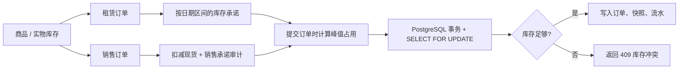

# RentSale 租赁售卖一体化平台

[](https://github.com/Rohing1/rentsale/actions/workflows/ci.yml)

一个面向设备、车辆、房源等可计量资产的 Go + PostgreSQL 管理平台。首版重点解决“同一库存既被卖出又被未来租单占用”的问题，并提供商品、客户、订单、收退款与基础运营看板。

> 当前范围是单组织、单库存池的管理后台。商品已预留 `location` 字段；多门店、商户隔离、电子合同和支付网关在下一阶段扩展。

## ☕ 赞赏支持

<table>
  <tr>
    <td align="center" width="360">
      <br />
      <sub>微信支付</sub>
    </td>
  </tr>
</table>

> 本项目免费开源，若它对你有帮助，欢迎扫码赞赏。每一份支持都会用于项目的持续维护与改进，感谢支持！

## 已实现

- 可同时设置“可租赁 / 可售卖”的商品，金额以分保存，避免浮点误差。
- 新增和查询客户、商品、库存调整。
- 多商品销售单和租赁单；订单保存 SKU、名称、售价、日租金与押金快照。
- PostgreSQL `daterange` 租期承诺与商品行锁，提交订单时计算区间内的最大并发占用，防止超租、超卖。
- 销售订单创建即扣减现货；取消销售单会恢复库存并记库存流水。
- 租赁订单可按“已确认 → 租赁中 → 已归还”流转；归还或取消后释放库存承诺。
- 订单与库存调整强制 `Idempotency-Key`；支付流水号全局唯一，网络重试不会重复扣减库存或重复入账。
- 手工收款 / 退款流水与订单收款状态；已有收款的订单需先登记退款，才可取消。
- 日、周、月、季度、年账单：按收退款登记日期汇总收款、退款、净收款，并可查看流水明细。
- 中文管理后台：看板、账单报表、商品与库存、客户、新建订单、订单状态操作。
- `healthz`、`readyz`、可选 `X-API-Key` 保护、请求超时、数据库自动迁移和优雅退出。
- 前端管理页与数据库迁移均可嵌入 Go 二进制，支持单文件 Windows `.exe` 发行。

## 核心库存逻辑



租赁使用左闭右开的 `[start_date, end_date)`：一笔订单在归还日结束，另一笔可以在同一天开始。PostgreSQL 的 `daterange` 和范围重叠运算非常适合排期；提交时仍会用 `SELECT ... FOR UPDATE` 锁定商品行，因为库存容量是数量聚合，单靠 GiST 索引不能判断“总量是否超额”。[PostgreSQL Range Types](https://www.postgresql.org/docs/current/rangetypes.html) 与 [Explicit Locking](https://www.postgresql.org/docs/current/explicit-locking.html) 是本实现的技术依据。

## 快速启动

### 方式一：Docker Compose（推荐）

前置条件：Docker Desktop。

1. 复制 `.env.example` 为 `.env`。
2. 为 `POSTGRES_DB`、`POSTGRES_USER`、`POSTGRES_PASSWORD` 和 `APP_API_KEY` 填入仅用于本地环境的值；不要提交 `.env`。`APP_API_KEY` 不应为空。
3. 在项目根目录执行：

```powershell
docker compose up --build
```

启动后打开 [http://localhost:8080](http://localhost:8080)，并在页面右上角输入同一个 API Key。Compose 只将 Web 服务绑定到 `127.0.0.1`，且不会把 PostgreSQL 端口暴露到宿主机；数据库数据保存在 Compose volume `postgres_data`。应用在启动时自动执行嵌入式 SQL 迁移。

### 方式二：Windows 本地运行

前置条件：Go 1.22+ 与可访问的 PostgreSQL 14+。

在项目根目录复制本地配置模板并填写数据库连接信息：

```powershell
Copy-Item .env.local.example .env.local
notepad .env.local
.\scripts\dev.ps1
```

脚本会读取 `.env.local`，默认执行迁移。`DB_PASSWORD` 不会写入代码或 Git；组件式配置也会安全处理密码中的 `@`、`:` 等字符。仅在明确已完成迁移时，才使用：

```powershell
.\scripts\dev.ps1 -SkipMigrate
```

## 环境变量

| 变量 | 必填 | 说明 |
| --- | --- | --- |
| `DATABASE_URL` | 本地运行时推荐 | PostgreSQL 连接串。不要写入代码或提交到 Git。 |
| `DB_HOST`、`DB_PORT`、`DB_NAME`、`DB_USER`、`DB_PASSWORD` | 本地或 Compose | 也可替代 `DATABASE_URL`；应用会安全编码用户名和密码中的 URL 特殊字符。 |
| `DB_SSLMODE` | 否 | 组件式数据库配置的 TLS 模式，默认 `disable`；仅受信任内网使用，启用 TLS 时设为 `require`。 |
| `APP_ADDR` | 否 | 服务监听地址，默认 `127.0.0.1:8080`。若改为非回环地址，必须同时设置 `APP_API_KEY`。 |
| `WEB_DIR` | 否 | 静态后台目录覆盖路径；留空时使用已嵌入二进制的管理后台。 |
| `AUTO_MIGRATE` | 否 | 是否在启动时执行迁移，默认 `true`。 |
| `BUSINESS_TIME_ZONE` | 否 | 业务日期时区，默认 `Asia/Shanghai`。 |
| `APP_API_KEY` | Compose / 非回环地址必填 | 所有 `/api/*` 请求必须携带 `X-API-Key`。本地回环开发可留空；生产环境请放在 HTTPS 反向代理之后，并替换为用户身份认证与 RBAC。 |

## 操作流程

1. 在“商品与库存”中新增商品，勾选可租赁、可售卖模式并填写现货。
2. 在“客户”中录入客户。
3. 在“新建订单”中选择租赁或销售：

   - 租赁：选择客户、起租与归还日期，再添加商品。系统计算该日期区间内的最大已占用量。
   - 销售：选择客户、商品和数量。系统会先预留未来已确认租赁所需的库存，再扣减可售现货。

4. 在“订单中心”完成取货、归还、完成交付或取消。
5. 使用“收 / 退款”登记资金流水。取消已有收款的订单前，应先登记对应退款。

## API 摘要

| 方法 | 路径 | 用途 |
| --- | --- | --- |
| `GET` | `/healthz` / `/readyz` | 存活与数据库就绪检查 |
| `GET/POST` | `/api/products` | 商品查询与创建 |
| `GET` | `/api/products/{id}` | 商品详情 |
| `GET` | `/api/products/{id}/availability` | 指定租期可用量 |
| `POST` | `/api/products/{id}/stock-adjustments` | 库存调整 |
| `GET/POST` | `/api/customers` | 客户查询与创建 |
| `GET/POST` | `/api/orders` | 订单查询与创建 |
| `GET` | `/api/orders/{id}` | 订单详情与价格快照 |
| `POST` | `/api/orders/{id}/status` | 取货、归还、完成或取消 |
| `GET/POST` | `/api/orders/{id}/payments` | 支付流水查询与登记 |
| `GET` | `/api/dashboard` | 运营看板 |
| `GET` | `/api/billing-reports` | 日 / 周 / 月 / 季度 / 年收退款账单 |

详细请求体与业务限制见 [docs/API.md](docs/API.md)。

## 项目结构

```text
cmd/server/                 服务入口与优雅退出
internal/config/            环境变量配置
internal/database/          pgx 连接池、嵌入式迁移
internal/store/             事务、库存承诺、订单和支付业务
internal/httpapi/           REST API、错误映射、可选 API Key
web/                        无框架中文管理后台
docs/                       API、痛点与优化方案
scripts/dev.ps1             Windows 本地启动脚本
```

## Windows 单文件 EXE

前端页面和数据库迁移均已编译进程序。可在安装 Go 1.22+ 的 Linux、macOS 或 Windows 构建机上生成 64 位 Windows 可执行文件：

```bash
CGO_ENABLED=0 GOOS=windows GOARCH=amd64 \
  go build -trimpath -ldflags="-s -w" \
  -o lease-platform.exe ./cmd/server
```

把 `lease-platform.exe` 单独复制到 Windows 目标机即可；不要设置 `WEB_DIR`，也不要将数据库密码编译进 EXE。通过 Windows 环境变量、受保护的服务配置或密钥管理系统提供 `DATABASE_URL`（或 `DB_*`）、`APP_API_KEY` 等运行配置。该 EXE 启动的是本地 Web 服务，访问 `http://127.0.0.1:8080` 使用后台。

## 自动构建与发布

- 推送到 `main` 或提交 Pull Request 时，GitHub Actions 自动运行测试、静态检查，并构建 Windows x64 EXE 作为下载产物。
- 推送 `v*` 标签（例如 `v0.1.0`）时，GitHub Actions 会再次验收代码并自动创建 Release，上传 Windows x64 ZIP 包和 SHA-256 校验文件。
- Release ZIP 包不含真实数据库配置或密钥，内含 EXE、环境变量模板和 README。

## 数据库升级提醒

本版本会把支付参考号升级为**全系统唯一**，以防同一第三方支付流水被重复登记到不同订单。升级已有数据库前，可先检查是否存在历史重复：

```sql
SELECT reference, COUNT(*) AS duplicate_count
FROM payments
GROUP BY reference
HAVING COUNT(*) > 1;
```

若查询有结果，请先在备份库核对并修正这些历史流水，再启动新版本。迁移会在发现重复参考号时停止，不会自动修改或删除任何收退款数据。

## 验证

已在临时 Go 1.22.12 工具链下执行：

```text
go test ./...
go vet ./...
```

两项均通过。当前工作机没有可用的 PostgreSQL 服务或 Docker，因此未能在本机执行真实 PostgreSQL 迁移和并发集成测试；部署前请按 [docs/API.md](docs/API.md) 的验收流程在目标环境跑一遍。

## 下一阶段建议

- 商品 × 门店库存池、调拨与配送/取还任务。
- 可序列化资产（二维码、SN、验机照片、维修和报损）。
- 订单支付超时释放、支付回调幂等键、电子合同和押金预授权。
- 运营人员、商户、客户的 RBAC、审计日志和多租户隔离。
- 逾期计费、续租、部分交接、损坏扣费、争议工单与通知任务。

业务痛点、已做优化和后续优先级见 [docs/pain-points-and-optimization.md](docs/pain-points-and-optimization.md)。
